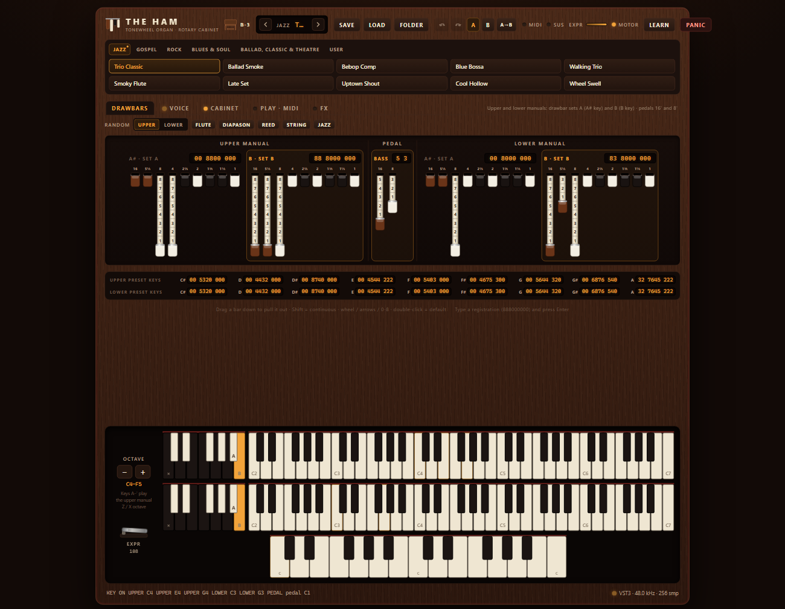
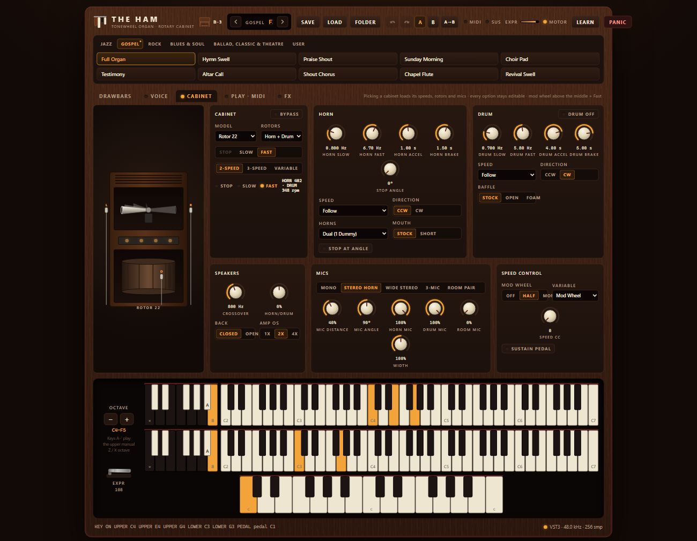

# The Ham: v0.5 (phase 5 of 6)

The Ham is a tonewheel organ modeled on the B-3, to be played through rotary cabinets modeled on the 122 and its
relatives. It is a model of the real instrument's architecture, not an oscillator-per-note synth: 91 tonewheels run all the
time on a gear train, every key closes nine contacts onto busbars, and the drawbars mix the busbars. It is the third
instrument in the family after [E-Piano](https://github.com/BlinkZer0/E-PianoVST) and
[Brass Knuckles](https://github.com/BlinkZer0/Brass-Knuckles), and is built the same way.

| Build | Where | Status |
|---|---|---|
| **VST3 plugin** + Standalone | [`vst/`](vst/README.md) | phases 1–5: tonewheel generator, drawbars, key click, percussion, scanner vibrato/chorus, expression, leakage, Age, four rotary cabinets, tube amp, outboard pedals, spring reverb, animated cabinet, the full UI and 50 level-matched presets; all automated checks pass |
| **Web build** | `web/index.html` (also served at https://blinkzer0.github.io/The-Ham/) | phase 6 |

The plan, the phases and the measured results are in [docs/PLAN.md](docs/PLAN.md). The house rules are in
[docs/CONVENTIONS.md](docs/CONVENTIONS.md).

## Screenshots

| DRAWBARS | CABINET |
|---|---|
|  |  |

The [VOICE](docs/screenshots/voice.png), [PLAY · MIDI](docs/screenshots/play.png) and [FX](docs/screenshots/fx.png)
pages are in `docs/screenshots/` (made by `vst\tests\screenshots.ps1` from the real UI with a stand-in bridge).

## What it does so far (phase 1)

### The tonewheel generator
- **91 wheels that never stop.** They are shared by every key and never reset by a key press, so chords are phase-locked
  and a re-struck note joins its wheel wherever it is.
- **Tuned by the gear train:** f = 20 rev/s × gear ratio × teeth. A is exactly 440 Hz, and the other notes sit up to
  2 cents off equal temperament, as on the instrument. **Tuning** A = 430–450 Hz, **60/50 Hz mains** (a 60 Hz organ on
  50 Hz runs 5/6 slow), **Transpose** ±12.
- The lowest wheels carry a little 3rd harmonic. The upper wheels fall off gently (filter capacitors).
- **Motor Start / Run:** Start spins the generator up; Run keeps it turning but can't start it. With both off (or a
  **Motor Off CC**) it coasts down: the power-off pitch dive.

### Keys, contacts and the key click
- Each key has **9 contacts** wired to wheels by the B-3 chart, **foldback** included. The bottom octave of the 16' folds
  up and the upper footages fold down near the top. Wheels 1–12 belong to the pedals. Key taper is per key range and
  footage.
- **Key click from the contacts themselves:** the nine contacts close at slightly different moments and bounce. No
  click sample or noise is added. **Click** per manual (0% = smooth onsets) and **Key-Up click** on/off.

### Drawbars
- Real **drawbars**: they pull down out of the panel, have 9 detents, are numbered 1–8 on the shaft, and have
  brown/white/black tips by footage. Drag (Shift = continuous), mouse wheel, arrow keys or 0–8, double-click = default.
  Every drawbar is host-automatable.
- **Two sets per manual** (A♯ and B preset keys) plus **pedal 16' and 8'**. The active set is lit. Each set shows its
  **registration string** (`88 8000 000`), and you can type one in.
- About **3 dB per step** (8 = 0 dB, 1 = −21 dB, 0 = off).
- **Preset keys** in reverse colours left of each manual: C cancel, C♯–A fixed registrations, A♯ set A, B set B.
- **Drawbar CC maps** for hardware controllers: B4D (CC 12–20 / 21–29, the default), Nord Electro (16–24 / 70–78),
  VK / CX-3 (70–78).

### Percussion, vibrato and chorus, expression
- **Percussion** on the upper manual: Second or Third harmonic, Fast or Slow decay, Normal or Soft. **Single trigger**: it
  sounds only on a note played after every upper key was up, so legato lines don't repeat it. It works only on drawbar
  set B and takes over the 1' bar. At Normal it lowers the drawbars a little, as on the B-3.
- **Scanner vibrato and chorus** V1–V3 / C1–C3: a scanner sweeps along an 18-section delay line at 6.9 Hz (it slows with
  the motor), with separate Upper and Lower switches. Chorus mixes the scanned signal with the straight one.
  Percussion and pedals bypass it.
- **Expression pedal** (CC11, settable, or the on-screen EXPR pedal): closing it cuts the mids and treble more than the
  bass, so it gets darker as well as quieter.

### Leakage, Age, sustain
- **Leakage** per manual: each wheel's compartment partner and the neighbouring busbars bleed in faintly, and there is a
  quiet floor of all 91 wheels that is always there, as on a real generator.
- **Age** per manual, from new to vintage: uneven key and wheel levels, extra 2nd and 3rd harmonics on the lower wheels,
  and more leakage.
- **Pedal sustain** and **lower-manual sustain** (off by default; the B-3 has neither). **Manual Bass**: the lowest
  lower-manual note also plays the pedals.

### Rotary cabinets
Four cabinets on one rotary engine. Picking one loads its speeds, rotors and mics, and every option stays editable:
**Rotor 22** (modeled on the 122: deep drum, wide swirl), **Rotor 45** (the 145: smaller, boxier, breaks up sooner),
**Single Rotor** (a Vibratone-style foam drum, no horn: narrow and watery) and **Tone Cabinet** (fixed speakers with a
built-in spring reverb).
- Horn and drum with their own **inertia**: Accel and Brake are the times to get within 2% of the new speed (exact,
  tested), so the horn reaches Fast in about a second and the drum in about four. Each rotor's Slow and Fast rates
  and direction can be set.
- **Doppler, amplitude modulation, directional filtering and cabinet reflections**, picked up by the mics you choose:
  mono, stereo horn + mono drum, wide stereo, 3-mic, or a front/back room pair, with distance, angle, levels and a
  room mic. Every combination is checked for mono compatibility.
- **Speed modes:** 2-speed, 3-speed (with Stop, and an optional horn stop at a chosen angle) and Variable (the mod
  wheel, the expression pedal or a CC sweeps the speed). Horn-only or drum-only speed changes, Drum Off.
- **Speed from** the switch, the mod wheel (half moon or momentary), a CC or the sustain pedal.
- **Layouts:** horn + drum, horn only, drum only, stationary; dual active horns; short horn mouth; open, stock or
  foam drum baffle; crossover and horn/drum balance; open or closed back.
- **Tube amp** with Drive: first-order ADAA at 1×, 2× or 4×, level-matched so driving it adds grit without changing
  the loudness. The 2× and 4× filters add 3 and 4 samples of delay, reported to the host.
- **Outboard pedals** before the cabinet: overdrive, wah (playable from the expression pedal) and tape echo with wow
  and flutter. **Spring reverb** after it. **Bypass** gives the dry organ.

### The UI
- **An animated cutaway of the cabinet**, driven by the engine's real rotor angles and speeds: you can see the horn
  reach Fast before the drum, and the drum keep turning after the horn has slowed. The horn blurs at speed. The drawing
  follows the cabinet model (cross-fade), the rotors, dual horns, an open back and where the mics are. It stops
  drawing when nothing moves or its page isn't shown.
- **Rocker tabs** for percussion, vibrato and the motor; an **expression pedal** that follows CC11; drawbars that slide
  to a new preset.
- **Undo / redo** (Ctrl+Z / Ctrl+Y), **A/B compare**, and **random drawbars** by family (flute, diapason, reed,
  string, jazz).
- Five pages (DRAWBARS, VOICE, CABINET, PLAY · MIDI, FX) with LEDs that show which features are on.

### Organ models
**B-3** (default), **C-3** (the same sound in a churchier case: it changes only the look), **A-100** (the B-3 voice with its built-in reverb), **M-3** spinet
(44-key manuals, no 16' on the lower manual, 13 pedals).

### Manuals and MIDI
- **Upper** (61 keys, channel 1), **Lower** (61, channel 2), **Pedals** (25, channel 3), each channel settable, or
  **Split** for one keyboard (lower | upper, optional pedal zone). Pedal MIDI Base sets the lowest pedal's note.
- **Velocity off** by default (organ keys are switches); optionally to volume or to click.
- On-screen manuals, preset keys and pedalboard; computer keys A–' play the upper manual.
- **Preset keys**: the fixed registrations C♯–A can be edited per manual (DRAWBARS page) and are saved with the project
  and in presets. Optional **keyswitches**: MIDI notes 24–35 on a manual's channel press its preset keys.
- **MIDI learn** on every control: LEARN, click a control, move a knob or fader. Right-click in learn mode forgets.
  Learned CCs are saved with the project and stay when you change presets.

### Coming next
The web build (phase 6): the same engine in the browser, with parity tests against the plugin.

## Build and install

Requirements: Windows, Visual Studio 2022 or 2026 with the C++ workload, Git, and the WebView2 runtime (built into
Windows 11). JUCE 8.0.17 is reused from Brass Knuckles' or E-Piano's build folder, or downloaded on the first build.

```
vst\build.bat      build the VST3, the Standalone app and the test tool (Release)
vst\install.bat    copy "The Ham.vst3" to C:\Program Files\Common Files\VST3 (asks for admin)
```

In the host, The Ham is an instrument with MIDI in and stereo out. All 143 parameters can be automated, and the factory
presets are host programs. Right-click any control for the host's parameter menu.

## Presets

50 factory presets, 10 per category, level-matched to within 0.05 dB of −18 dB. Every preset loads its cabinet whole (the
model's rotors, speeds, ramps and mics, as picking it in the UI does); every cabinet appears in at least 6 presets, three
presets sweep the speed from the mod wheel (Variable), four use the outboard pedals. **The vibrato / chorus is a per-preset
choice, not a default**: the C3 chorus turns at 6.9 Hz and is easy to mistake for a fast rotor, so it is on only where it
belongs to the sound (see "Status" below). User presets are `.hampreset` files (plain JSON, versioned) in
**`Documents\The Ham\Presets`**. Drawbars are saved as whole steps.

Registrations are upper · lower · pedal (16' 5⅓' 8' 4' 2⅔' 2' 1⅗' 1⅓' 1'; pedals 16' 8'), all on drawbar set B. The
registrations are the commonly published classic settings for each style, as starting points: tell me what sounds off.

**Jazz**

| Preset | Upper | Lower | Pedal | Percussion | Vibrato | Cabinet | Also |
|---|---|---|---|---|---|---|---|
| Trio Classic | 88 8000 000 | 83 8000 000 | 53 | 3rd soft fast | C3 upper | Rotor 22 · Slow | – |
| Ballad Smoke | 83 8000 000 | 00 8000 000 | 43 | – | C1 upper | Rotor 22 · Slow | – |
| Bebop Comp | 80 8000 000 | 84 8000 000 | 53 | 2nd normal fast | – | Rotor 45 · Slow | – |
| Blue Bossa | 86 8000 000 | 00 8000 000 | 53 | – | C2 upper | Rotor 22 · Slow | – |
| Walking Trio | 88 8000 000 | 80 8000 000 | 85 | 3rd soft slow | C3 upper | Rotor 22 · Slow | manual bass |
| Smoky Flute | 00 8000 000 | 00 8000 000 | 42 | – | C1 upper | Single Rotor · Slow | mics at 60% |
| Late Set | 88 8800 000 | 83 8000 000 | 53 | 2nd soft fast | – | Rotor 22 · Fast | – |
| Uptown Shout | 88 8888 000 | 84 8000 000 | 63 | 3rd normal fast | – | Rotor 45 · Fast | drive 30% |
| Cool Hollow | 80 0008 000 | 00 8000 000 | 43 | – | C3 both | Rotor 22 · Slow | – |
| Wheel Swell | 88 8000 000 | 83 8000 000 | 53 | 3rd soft fast | C3 upper | Rotor 22 · Variable (mod wheel) | – |

**Gospel**

| Preset | Upper | Lower | Pedal | Percussion | Vibrato | Cabinet | Also |
|---|---|---|---|---|---|---|---|
| Full Organ | 88 8888 888 | 88 8800 000 | 85 | – | – | Rotor 22 · Fast | – |
| Hymn Swell | 88 6000 000 | 00 8800 000 | 64 | – | – | Tone Cabinet | – |
| Praise Shout | 88 8888 888 | 88 8000 000 | 85 | 3rd normal fast | – | Rotor 45 · Fast | drive 35% |
| Sunday Morning | 88 8800 000 | 83 8000 000 | 64 | – | C3 upper | Rotor 22 · Slow | – |
| Choir Pad | 68 8600 000 | 00 8800 000 | 53 | – | C2 both | Rotor 22 · Slow | – |
| Testimony | 88 8866 000 | 84 8000 000 | 74 | 2nd normal slow | – | Rotor 22 · Fast | – |
| Altar Call | 86 6800 000 | 83 8000 000 | 53 | – | C1 upper | Rotor 22 · Slow | drive 30% |
| Shout Chorus | 88 8888 888 | 88 8800 000 | 85 | 3rd soft fast | – | Rotor 45 · Fast | drive 50% |
| Chapel Flute | 00 8000 000 | 00 8000 000 | 42 | – | V1 upper | Tone Cabinet | reverb 10% |
| Revival Swell | 88 8888 888 | 88 8000 000 | 85 | – | – | Rotor 22 · Variable (mod wheel) | – |

**Rock**

| Preset | Upper | Lower | Pedal | Percussion | Vibrato | Cabinet | Also |
|---|---|---|---|---|---|---|---|
| Overdrive Stack | 88 8000 000 | 84 8000 000 | 63 | – | – | Rotor 45 · Fast | drive 70% |
| Rock Pad | 88 8800 000 | 00 8800 000 | 53 | – | C3 upper | Rotor 22 · Slow | – |
| Baroque Rock | 68 8600 000 | 00 8800 000 | 53 | – | C3 both | Rotor 22 · Slow | drive 25% |
| Grind Comp | 88 8888 888 | 88 8000 000 | 85 | – | – | Rotor 45 · Fast | drive 80%, overdrive 50% |
| Garage Fuzz | 88 6000 000 | 84 8000 000 | 63 | 3rd normal fast | – | Single Rotor · Slow | drive 60%, overdrive 70% |
| Psychedelic Swirl | 88 8000 008 | 80 8000 000 | 53 | – | C3 both | Single Rotor · Fast | tape echo 0.35 s |
| Prog Lead | 80 0000 008 | 00 8000 000 | 43 | 3rd normal fast | – | Rotor 22 · Fast | drive 50% |
| Arena Chords | 88 8888 888 | 88 8800 000 | 85 | – | – | Rotor 22 · Fast | drive 40%, wide stereo mics |
| Dirty Shuffle | 88 8000 000 | 83 8000 000 | 63 | 2nd soft fast | – | Rotor 45 · Slow | drive 60%, amp 4× |
| Wah Lead | 88 8888 888 | 00 8000 000 | 43 | – | – | Rotor 22 · Fast | drive 30%, wah on the expression pedal |

**Blues & Soul**

| Preset | Upper | Lower | Pedal | Percussion | Vibrato | Cabinet | Also |
|---|---|---|---|---|---|---|---|
| Memphis Soul | 88 8800 000 | 83 8000 000 | 53 | 2nd soft fast | – | Rotor 22 · Slow | drive 30% |
| Motown Pad | 80 8808 008 | 00 8800 000 | 53 | – | C3 upper | Rotor 22 · Slow | – |
| Slow Blues | 83 8000 000 | 00 8000 000 | 53 | 3rd soft slow | C1 upper | Single Rotor · Slow | – |
| Juke Joint | 88 8000 000 | 84 8000 000 | 64 | 3rd normal fast | – | Single Rotor · Slow | drive 50% |
| Funk Comp | 80 8000 008 | 00 8800 000 | 53 | 2nd normal fast | – | Rotor 45 · Fast | – |
| Soul Ballad | 86 8600 000 | 00 8000 000 | 43 | – | C2 upper | Rotor 22 · Slow | reverb 15% |
| Gospel Blues | 88 8866 000 | 83 8000 000 | 64 | – | C3 upper | Rotor 22 · Fast | – |
| Greasy Shuffle | 88 8000 008 | 84 8000 000 | 64 | 3rd soft fast | – | Rotor 45 · Slow | drive 40% |
| Soul Shout | 88 8888 000 | 88 8000 000 | 74 | – | – | Rotor 22 · Fast | drive 30% |
| Swamp Stomp | 88 8000 000 | 83 8000 000 | 63 | 3rd normal fast | – | Single Rotor · Variable (mod wheel) | drive 50% |

**Ballad, Classic & Theatre**

| Preset | Upper | Lower | Pedal | Percussion | Vibrato | Cabinet | Also |
|---|---|---|---|---|---|---|---|
| Flute 8' | 00 8000 000 | 00 8000 000 | 42 | – | – | Tone Cabinet | – |
| Bach Plenum | 86 8868 000 | 86 8000 000 | 64 | – | – | Tone Cabinet | reverb 15% · 3 s |
| Theatre Tibia | 80 8000 000 | 00 8000 000 | 53 | – | V3 both | Tone Cabinet | reverb 10% |
| Silent Film | 88 8888 888 | 88 8000 000 | 64 | – | V3 both | Tone Cabinet | – |
| Cathedral Swell | 68 6000 000 | 00 8000 000 | 53 | – | – | Tone Cabinet | reverb 25% · 3 s |
| String Ensemble | 20 6788 776 | 00 6000 000 | 43 | – | C1 both | Rotor 22 · Slow | – |
| Reed Oboe | 00 7785 640 | 00 8000 000 | 43 | – | V2 upper | Tone Cabinet | – |
| Clarinet Solo | 00 6806 000 | 00 8000 000 | 43 | – | V2 upper | Rotor 22 · Slow | – |
| Ballad Pad | 83 8000 000 | 00 8800 000 | 53 | – | C3 both | Rotor 22 · Slow | reverb 20% |
| Theatre Pipes | 88 8888 888 | 88 8800 000 | 85 | – | C3 both | Rotor 22 · Slow | reverb 25%, wide stereo mics |

## Status and known limitations

- **Still to confirm by hand** in Minihost Modular: everything in phases 1–5 (see "What to listen for" in
  [docs/PLAN.md](docs/PLAN.md)). The scanner depths, the percussion decay times, the cabinet voicings and the 50
  registrations in particular need judging by ear.
- **"The rotary seems to run all the time"**: that is most likely the **scanner chorus** (VOICE page, VIB SWELL /
  VIB GREAT and V1–C3), not the cabinet. C3 turns at 6.9 Hz and, on a single note, swings the level by about 21 dB,
  more than the rotor itself; the earlier starter presets had it on everywhere. The rotor itself was checked through
  the built plugin: Slow, Fast, Stop, Bypass, the Tone Cabinet and a changed Horn Fast rate all measure as set
  (`TheHamTests --host-rotor`). Whether C3 is too deep is a by-ear question: the scanner depths are estimates.
- Pedal drawbar mixtures, the per-wheel voicing, the scanner depths, the lower manual's preset chart, the cabinet
  voicings and the M-3's taper are approximations. No published data was found; see the reference table in the plan.
- Windows only for now. The code is portable JUCE, but no macOS build has been set up.

"B-3" and "122" name the instruments this is modeled on. The plugin, its UI and its presets use generic names.

## Repository layout

```
vst/                      VST3 plugin (JUCE 8): Source/, ui/, presets/, tests/  (webhost/ in phase 6)
docs/                     CONVENTIONS.md, PLAN.md, screenshots/ (index.html in phase 6)
start.bat, serve.ps1      local server (serve.ps1 -Ui previews the UI without an engine)
```
